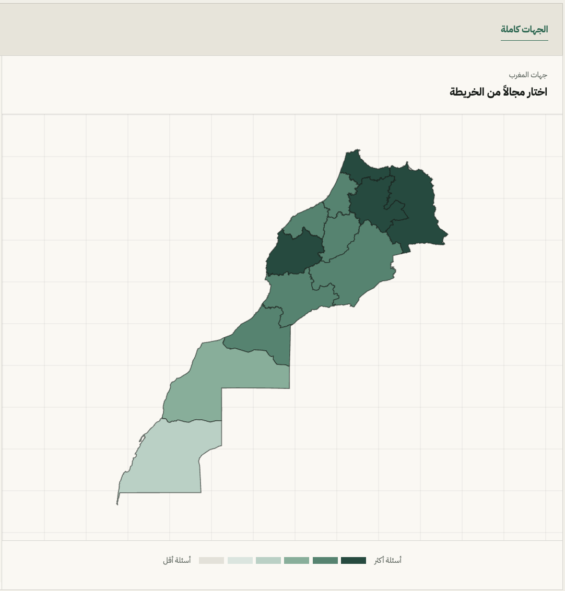
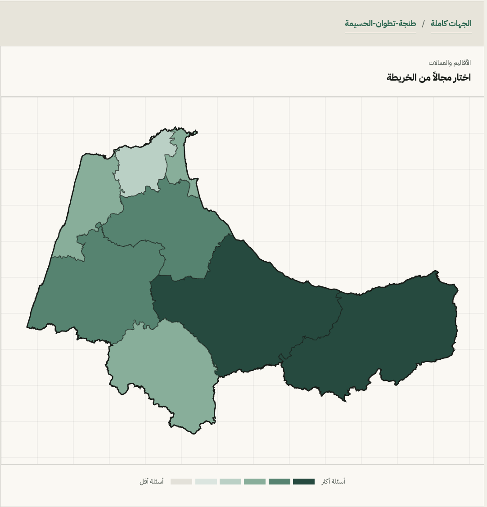
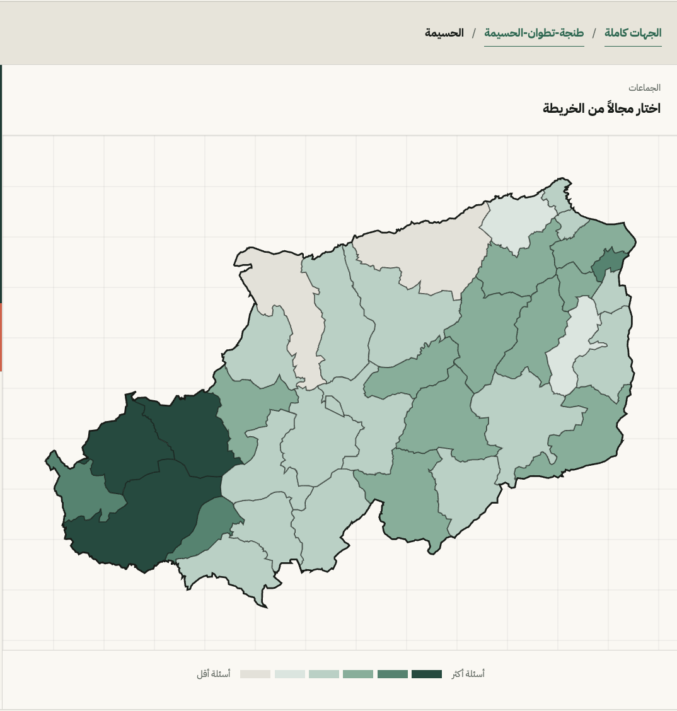

# Morocco Geospatial Visualisations

Reusable administrative boundaries for Morocco, packaged for maps, charts, GIS tools, and web applications.

The repository contains the geography used by [Open Barlaman](https://www.openbarlaman.com/), at three administrative levels:

- 12 regions
- 75 provinces and prefectures
- 1,540 communes in the recommended RGPH 2024 dataset

## Example of usage

<table>
  <tr>
    <td width="33%"></td>
    <td width="33%"></td>
    <td width="33%"></td>
  </tr>
</table>

## Dataset catalogue

| Dataset | Format | Features | Recommended use |
| --- | --- | ---: | --- |
| `data/rgph-2024/regions.geojson` | GeoJSON | 12 | National and regional maps |
| `data/rgph-2024/provinces.geojson` | GeoJSON | 75 | Province/prefecture maps |
| `data/rgph-2024/communes.geojson` | GeoJSON | 1,540 | Commune-level maps and joins |

The files have consistent hierarchical codes and Arabic and French names.

## RGPH 2024 schema

Every RGPH file is a GeoJSON `FeatureCollection` in WGS 84 longitude/latitude coordinates (`EPSG:4326`). Features contain a `Polygon` or `MultiPolygon` and these properties:

```json
{
  "code": "MA-01-051-0101",
  "name_ar": "الحسيمة",
  "name_fr": "Al Hoceima"
}
```

Codes encode the hierarchy:

```text
MA-01               region
MA-01-051           province or prefecture
MA-01-051-0101      commune
```

Remove the last hyphen-separated segment to obtain a feature's parent code. For example, the parent of commune `MA-01-051-0101` is province `MA-01-051`, whose parent is region `MA-01`.

These are map-derived, zoom-level 7 boundaries. They are suitable for thematic maps and web visualisations, but they are simplified and are not an official full-resolution GIS release.

## Use in JavaScript

Load GeoJSON directly in a browser or a framework such as MapLibre GL JS, Leaflet, or D3:

```js
const response = await fetch('/data/rgph-2024/regions.geojson')
const regions = await response.json()

for (const feature of regions.features) {
  console.log(feature.properties.code, feature.properties.name_fr)
}
```

MapLibre GL JS example:

```js
map.on('load', () => {
  map.addSource('morocco-regions', {
    type: 'geojson',
    data: '/data/rgph-2024/regions.geojson',
  })

  map.addLayer({
    id: 'morocco-region-fill',
    type: 'fill',
    source: 'morocco-regions',
    paint: {
      'fill-color': '#c96b42',
      'fill-opacity': 0.65,
      'fill-outline-color': '#ffffff',
    },
  })
})
```

## Use in Python

With GeoPandas:

```python
import geopandas as gpd

regions = gpd.read_file("data/rgph-2024/regions.geojson")
regions.plot(column="code", edgecolor="white", legend=False)
```

Filter communes belonging to a province by code prefix:

```python
communes = gpd.read_file("data/rgph-2024/communes.geojson")
al_hoceima = communes[communes["code"].str.startswith("MA-01-051-")]
```

## Use from the command line

Inspect a file with GDAL/OGR:

```sh
ogrinfo -so data/rgph-2024/regions.geojson regions
```

Convert GeoJSON to GeoPackage:

```sh
ogr2ogr morocco.gpkg data/rgph-2024/regions.geojson -nln regions
ogr2ogr -update -append morocco.gpkg data/rgph-2024/provinces.geojson -nln provinces
ogr2ogr -update -append morocco.gpkg data/rgph-2024/communes.geojson -nln communes
```

## Joining your data

Prefer joining statistics to the RGPH files with the `code` property rather than a place name. Names can differ in spelling, punctuation, transliteration, or administrative wording.

```js
const valuesByCode = new Map([
  ['MA-01', 42],
  ['MA-02', 57],
])

for (const region of regions.features) {
  region.properties.value = valuesByCode.get(region.properties.code) ?? null
}
```
